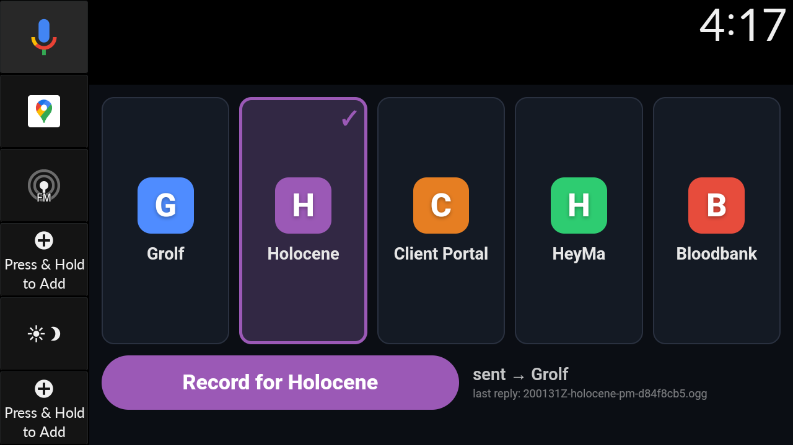
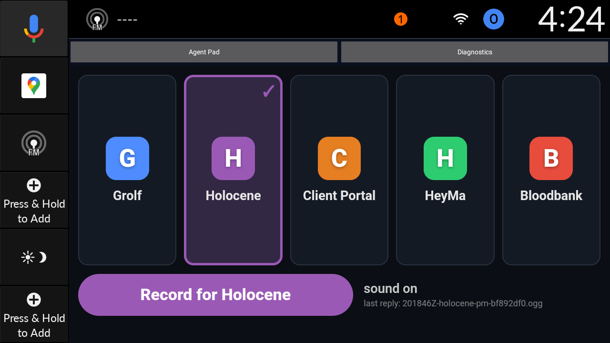
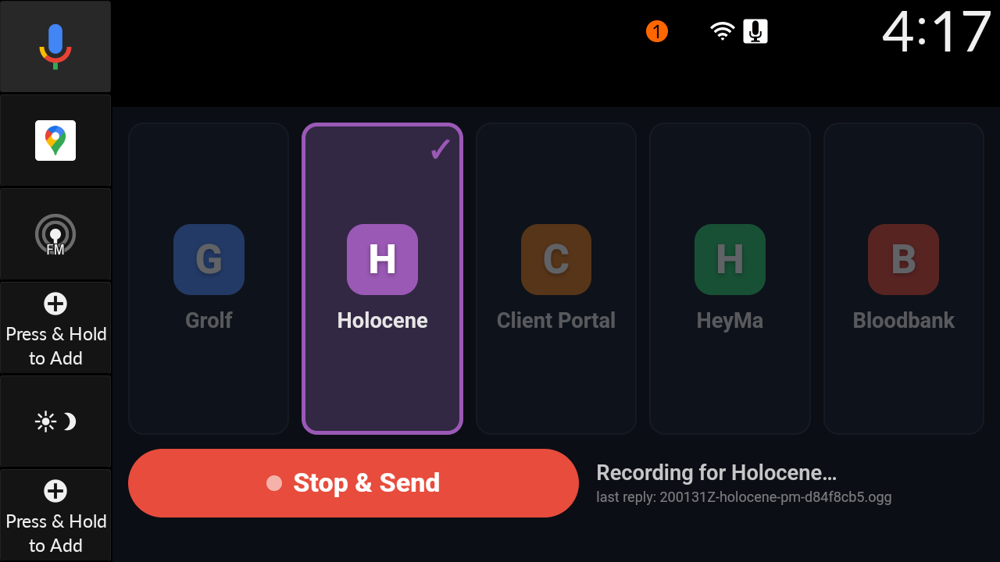
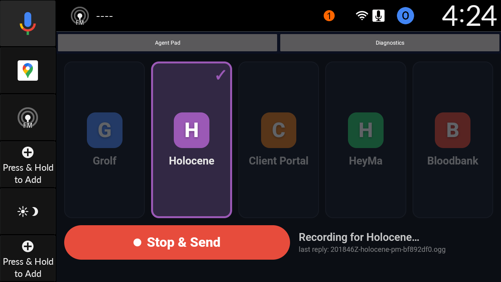
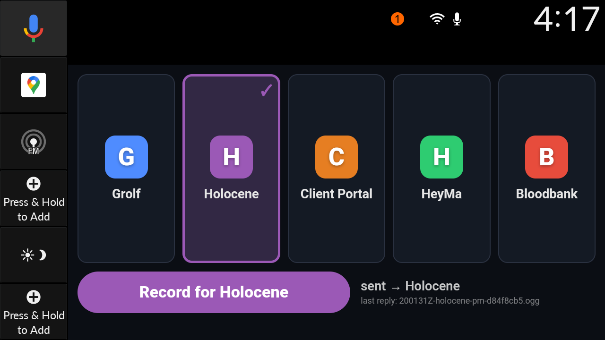
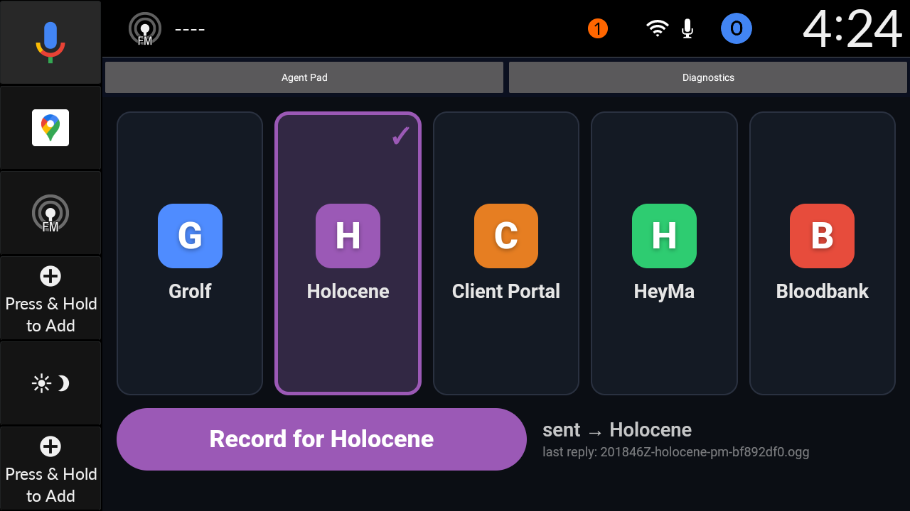
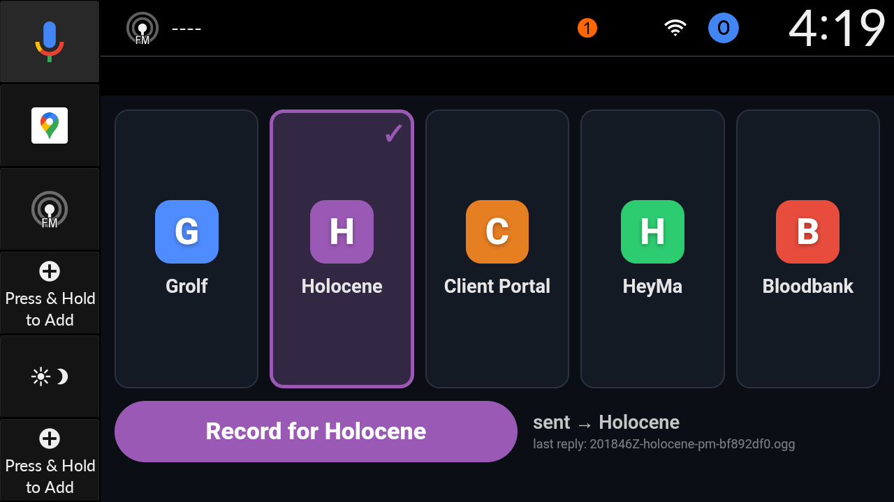
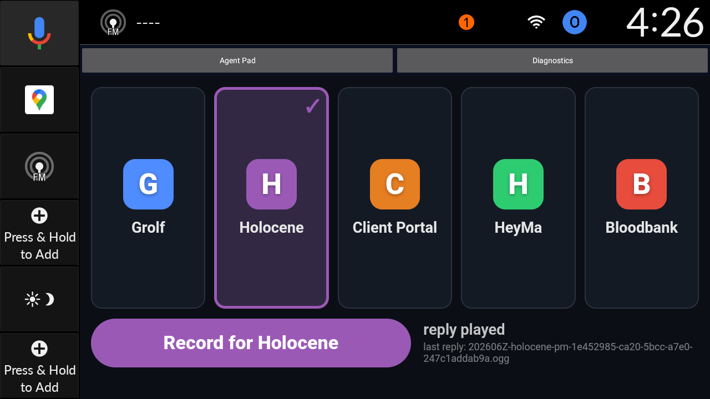

# Holocene Auto voice pipeline: end-to-end proof on the Honda simulator

Date: 2026-10-15. Simulator `emulator-5554` (HOLOC_9_Honda_API33, windowed, still running with the app open).

Claim proven: a recording made inside Holocene Auto on the Honda simulator was uploaded, transcribed,
delivered as the prompt of a Bloodbank `agent.invocation.start` command to the intended agent
(`holocene-pm`), answered, spoken, and played back inside the app. Twice. Every hop has evidence.

## The two memos

| | Attempt 1 | Attempt 2 (final code) |
|---|---|---|
| memo_id | `bf892df0-eec9-5f12-971c-f947fee14d2a` | `1e452985-ca20-5bcc-a7e0-247c1addab9a` |
| audio object | `inbox/holocene-pm/2026/10/15/20261015T201741Z.ogg` (35,036 B) | `inbox/holocene-pm/2026/10/15/20261015T202453Z.ogg` (41,263 B) |
| command_id | `9e17a185-6fc2-43c0-98bc-ad7eaba5bfcb` | `bfebbec1-ef47-4f17-8e03-34522121eeff` |
| reply object | `replies/2026/10/15/201846Z-holocene-pm-bf892df0.ogg` | `replies/2026/10/15/202606Z-holocene-pm-1e452985-ca20-5bcc-a7e0-247c1addab9a.ogg` |
| verdict | COMPLETE in 65.0 s, playback not reported (pad predated the beacon) | COMPLETE in 74.0 s, played on the pad +3.5 s after the reply was rendered |

The memo id is `uuid5(NAMESPACE_URL, "s3://holocene-auto/" + key)`. It is the Bloodbank `correlationid` of every
fact and of the command, so `curl 'http://127.0.0.1:8683/events?correlationid=<memo_id>&limit=100'` returns the
whole journey.

## How the known utterance reached the simulator microphone

Option (a), gRPC audio injection, worked. The running emulator had no gRPC bridge, so I made the fix permanent:
`apps/auto/tools/sim_start.sh` now launches the emulator with `-grpc 8554 -grpc-use-token`
(`SIM_GRPC_PORT` in `sim_env.sh`), then restarted with `mise run auto:sim:stop && mise run auto:sim`. The window
came back, the discovery file `pid_*.ini` appeared, and `emulator_audio.py status --port 8554 --disable-host-mic`
answered `unauthenticated=UNAUTHENTICATED, authenticated=OK, microphone_real_audio=false` (host mic no longer mixes
in, so no room noise and nothing on Jarad's speakers).

Utterance: `make_known_utterance.py --voice kal16`, phrase
"Holocene pipeline test. Please reply with the words pipeline check received." (4.905 s; the default voice
renders 5.06 s, which is over the harness's 5 s cap, so `kal16` was used). Injected with
`emulator_audio.py inject --port 8554 --wav utt.wav --lead-ms 500 --tail-ms 1500` while the app was recording.

Steps in the app (adb taps on the new 1280x720 tiles, screenshots viewed at each step):
select Holocene tile -> Record -> inject -> Stop & Send.

| Attempt 1 | Attempt 2 |
|---|---|
|  |  |
|  |  |
|  |  |
|  |  |

The recorded OGG (attempt 1) is 7.38 s, mean volume -30.3 dB, max -8.2 dB: not silence.

## Per-hop evidence, attempt 2 (all times UTC, 2026-10-15)

Full output: `pipeline-e2e/trace-a2.txt` (attempt 1: `trace-a1.txt`). Live view: `pipeline-e2e/voice-view-a2.png`.

| # | Hop | Evidence | Time | Since previous |
|---|---|---|---|---|
| 0 | Stop & Send tapped | adb tap | 20:24:52.4 | |
| 1 | upload proxy log | `docker logs agent-pad-upload`: `{"event":"upload","key":"inbox/holocene-pm/2026/10/15/20261015T202453Z.ogg","memo_id":"1e452985-...","agent":"holocene-pm","bytes":41263,"status":200,"s3_ms":93}` | 20:24:54.780 | +2.4 s |
| 2 | S3 object | `mc ls`: `inbox/holocene-pm/2026/10/15/20261015T202453Z.ogg` 41,263 B | 20:24:54 | |
| 3 | fact `audio.memo.uploaded` | published by the proxy over NATS, fact id `9a5337a4-bb6a-4bb7-b615-96d81e56e179` | 20:24:54.787 | |
| 4 | fact `audio.memo.received` | watcher picked it up, lag 4,040 ms (5 s poll) | 20:24:58.8 | +4.0 s |
| 5 | fact `audio.memo.transcribed` | large-v3 on CPU (GPU full), 45.57 s. Transcript below | 20:25:46.9 | +48.1 s |
| 6 | fact `audio.memo.dispatched` | command `bfebbec1-...` on `bloodbank.cmd.agent.invocation.start`, `target_agent_id` from the S3 key path | 20:25:48.7 | +1.9 s |
| 7 | gateway journal | `executions` row for exactly that command_id: profile `holocene-pm`, state `completed`, outcome `success`, created 20:25:48.745, updated 20:25:59.221 | 20:25:48.7 | +0.7 s |
| 8 | `agent.invocation.started` | producer `hermes-agent:holocene-pm`, same correlationid | 20:25:48.746 | +22 ms |
| 9 | `agent.invocation.completed` | same correlationid and command_id | 20:25:59.222 | +10.5 s |
| 10 | fact `audio.memo.replied` | 23 chars spoken, tts 2.09 s (vibevoice) | 20:26:10.2 | +10.9 s |
| 11 | reply object | `replies/.../202606Z-holocene-pm-1e452985-....ogg` 5,954 B | 20:26:08 | |
| 12 | pad playback beacon | proxy log `{"event":"playback","phase":"started",...}` then `"phase":"ended"` | 20:26:11.459 / 20:26:13.073 | +1.3 s |
| 13 | fact `audio.memo.played` | phase started (reply 5,459 ms old) and ended (1.47 s of audio) | 20:26:11.46 | |
| 14 | pad UI | status "reply played", `last reply: 202606Z-holocene-pm-1e452985-...ogg` (screenshot a2-4); logcat `AudioFocusControl MM_AF,REQUEST,ENTER` 16:26:10.773 and `ABANDON` 16:26:12.472 (local time) | | |

Total, upload fact to reply fact: 75.4 s. Total to playback ended: 78.3 s. Where the time goes: transcription 48 s
(64%), agent turn 10.5 s, TTS plus upload 10.9 s. Attempt 1 had the same shape: transcribe 44 s, agent 9.0 s,
reply +11.0 s.

### Transcript versus the known phrase

Known: `Holocene pipeline test. Please reply with the words pipeline check received.` (12 words)
Heard (both attempts, identical): `Holocene pipeline test. Please reply with words pipeline check received.` (11 words)

One word differs: Whisper dropped "the". Every other word matches apart from case and punctuation. This is Whisper
on a flite voice, not a pipeline fault.

### The prompt the agent actually received

The Hermes `holocene-pm` profile `state.db`, session `source='bloodbank'` with `chat_id` = memo_id, for attempt 2:

```
user      | Holocene pipeline test. Please reply with words pipeline check received.
assistant | pipeline check received
```

The user message is the transcript, character for character. The agent did what the transcript asked, and its answer
is what was spoken back (`/voice` shows "Heard" and "Agent said"). Attempt 1 is identical (session
`20261015_161829_e00b9848`, command `9e17a185-...`). Query used:
`sqlite3 -readonly ~/.hermes/profiles/holocene-pm/state.db "select role, content from messages where session_id=(select id from sessions where chat_id='<memo_id>' and source='bloodbank') order by timestamp"`.

### Holocene `/voice`

`GET /api/modules/voice/memos/<memo_id>` returns status `complete`, 8 hops, all `ok`, total 75.4 s
(`voice-api-a1.json` holds attempt 1's raw response). The rendered page is `pipeline-e2e/voice-view-a2.png`
(headless Chrome against the `holocene-web` container; the public URL sits behind Google OIDC).

## Failures hit, and what I changed

The pipeline itself passed on the first recording. Everything below is a failure found on the way, or an
observability gap closed.

1. **Gateway and watcher preconditions.** Both were already fixed by earlier tasks (gateway `bloodbank` connected,
   `holocene-inbox-watcher.service` active). The emulator needed the gRPC flag (above).
2. **Phantom memos from an `mc` quirk (found live, fixed).** `mc ls --recursive --json` intermittently (about 1
   listing in 15) returns keys relative to the bucket (`inbox/<agent>/...`) instead of the listed prefix. The
   watcher doubled the prefix, took `inbox` for an agent id, "discovered" two of today's old objects as
   `inbox/inbox/33god-pm/...`, failed to download them three times, and published `audio.memo.failed` facts.
   This was visible: the failure appears in the watcher log, in `memo:trace`, and as red "Failed at watcher picked
   up" rows (agent `inbox`) on `/voice`. Fix: list `inbox/` with a trailing slash, strip a leading `inbox/` once,
   treat an `mc` error line as a failed listing; unit test added (commit `5531f73`). I removed the 7 phantom entries
   from the watcher state. The failed facts themselves are immutable bus history, so those four phantom rows
   stay in the `/voice` list until the retention window ages them out.
3. **Failure with a deleted or phantom object was not traceable.** `memo:trace <memo_id>` said "no inbox object
   matches". It now resolves a full memo id through the bus (`data.s3_key`) when the object is gone, so a
   phantom or deleted memo still shows its failures.
4. **Playback was the one unobservable hop.** The pad only polled the bucket, so `memo:trace` printed UNKNOWN for it.
   Added the full path (details below).
5. **`memo:trace` verdict bug.** A memo that failed one attempt and then succeeded was reported "STOPPED AT
   fact:failed[...]". Retryable failed facts are now annotations; the stage hop decides the verdict.
6. **`upload_proxy_log` hop matched the wrong line** once beacons existed (it took the last log line mentioning the
   memo). It now selects the `upload` event, and the playback hop selects the `playback` event by its own memo id.
7. **Pad replayed an old reply on every app start.** A fresh start auto-played the newest reply already in
   today's bucket. Now a reply older than 5 minutes at first poll is marked seen, not played.

### New: the playback hop (`audio.memo.played`)

- Bloodbank (`55cd4ab`): new `audio.memo.played` fact (`phase` started|ended, `played_seconds`, `reply_age_ms`),
  new `failed` stage `playback`, schema, allowlist, `docs/event-naming.md`, tests. `validate:schemas` and
  `smoketest:bloodbank-naming` pass.
- Agent Pad: when a reply starts, ends, errors, or is blocked because sound is locked, it POSTs a beacon to
  `/upload/played`. Fire-and-forget, so it cannot affect playback.
- Upload proxy: logs a `playback` line and publishes `played`, or `failed(stage=playback, retryable)` for errors. The memo
  id comes from the reply key, which now carries the full memo id
  (`replies/<date>/<HHMMSS>Z-<agent>-<memo_id>.ogg`).
- `memo:trace`: `pad_playback_log` and `played_on_pad` hops; the verdict says whether playback was reported.
- Holocene `/voice`: eighth hop "Played on car". It is optional. A parked car reports nothing, and that must not turn
  a memo red. A playback failure shows on that hop without flipping the memo to failed.
  API tests: 48 pass; both typechecks clean. API restarted, web recreated, pad rebuilt and served.

Holocene commits: `5531f73`, `e041234`, plus the pad fix and this report. Bloodbank `55cd4ab`.

## What is proven

- A recording made by the real Holocene Auto app (native recorder, WebView, new car-size tiles) on the Honda
  simulator reached S3 through the upload proxy, with log lines and a bus fact at that hop.
- The watcher transcribed it and published the transcript; the transcript was dispatched with `bb` as
  `bloodbank.cmd.agent.invocation.start` to the agent named in the tile the user pressed (`holocene-pm`).
- The gateway journal row, the `agent.invocation.*` facts and the Hermes session all tie to the same command id and
  memo id; the agent's input equals the transcript.
- The reply was rendered to speech, uploaded, and played inside the app on the simulator, reported by the pad itself.
- Every hop is observable by one id: `mise run memo:trace`, the `/voice` page, Candystore by correlationid, the
  structured logs of the proxy and the watcher.
- Two runs, 65 s and 74 s end to end, with no stale-command interference (the gateway queue was drained earlier). Correction from review: attempt 1 predates the playback beacon, and its frame `a1-4` shows only the `last reply:` line (status 'sent'), not 'reply played'. Attempt 1's playback rests on logcat audio focus plus that line; attempt 2 and round 3 below have the beacon.

## What is not proven

- **Acoustic path.** The utterance was injected as PCM into the emulator's audio input. No real microphone, cabin
  noise, or head-unit audio stack was involved. The physical phone and a real Honda unit were not touched.
- **Audible output.** Playback is proven by the app's own audio element events, the pad status text and Android
  audio focus in logcat, not by capturing the emulator's output.
- **Transcript fidelity.** One word ("the") dropped, on a synthetic flite voice. Real speech was not tested.
- **Latency headroom.** 74 s is dominated by CPU Whisper because the RTX 3090 has about 4 GB free. A cold GPU would
  cut about 40 s. A busy gateway queue adds the wait (the earlier 14-minute run).
- **Late replies.** An agent that finishes after the watcher's 600 s deadline gets no spoken reply (documented).
- **The public `/voice` URL** is behind Google OIDC; I verified the same build through the container.
- **Where the ~3 s upload gap goes.** Stop tapped to upload fact is 2.4 s; the native recorder's finalise step
  is not instrumented.
- `audio.memo.played` ended-phase reporting relies on the WebView firing `ended`; a car that is switched off mid-reply
  reports `started` without `ended`, which the trace shows as "end not reported".


## Review round: findings fixed (same evening)

An independent review of the pipeline found the gaps below. All are fixed, deployed and covered by tests where the
repo has them. Round-3 evidence follows the table.

| Finding | Fix |
|---|---|
| Truncated upload stored as a complete memo | Proxy rejects a body shorter than Content-Length (400 `short_body`) and publishes `failed(stage=upload)`; `.ogg` keys must hold an `OggS` stream. Tested over a real socket. |
| Transcribe timeout (420 s) < audio the app allows; one memo blocks the whole loop | Timeout = `max(420, 60 + 8 x ffprobe duration)`, grows after a timeout. transcribe/dispatch/speak run on worker threads; `tick()` keeps discovering, polling and writing the heartbeat (which now lists the running step and its age). |
| ~8 loud phone pushes per memo | ntfy-router: `audio.memo.*` progress facts muted; only `audio.memo.failed` and `audio.file.*` page the phone (bloodbank `036a019`, redeployed). |
| Post-agent stages gave up after ~45 s, no replay | Infra stages retry on a time budget (dispatch 15 min, tts/reply upload 30 min). `mise run memo:retry <memo_id>` revives a failed memo at the stage it died in. |
| Shared FIFO queue; a timed-out command still ran later, silently | Agent deadline extends (up to 1 h) while the command is verifiably queued/running; after a real timeout the watcher keeps watching the command for 2 h and speaks a late reply. **Not fixed:** a priority lane needs a second consumer in the Hermes gateway plugin (documented limit). |
| Pad silently dropped replies (burst, restart, 50-key cap, midnight) | Ordered reply queue; listing uses `start-after` with paging (no 50 cap); persisted `lastDone`; yesterday and today covered; replies up to 30 min old play after a restart; stale replies get a `skipped` beacon. Legacy flat `replies/2026101...` keys are ignored so they cannot pin the cursor. |
| Upload failure and pre-upload failures invisible | Pad keeps the recording in IndexedDB and retries (5 tries, then every 30 s and on `online`); `POST /upload/client-event` for record start/stop/failure and upload failure; `failed(stage=record\|upload)` facts keyed by the key the memo would have had; memo id shown on screen. |
| Unroutable agent: dropped by the gateway, memo hangs 10 min with a vague failure | Agent id checked against `agents-registry.yaml` right after `received` (`dispatch/unknown_agent`, milliseconds). Fallback: no journal row + empty consumer for 15 s => `agent/gateway_terminated` carrying the gateway's own WARNING line. `memo:trace` gained `gateway_log` and `agent_route` hops; `/voice` fails the *Agent started* hop for a no-row timeout. A test asserts every pad tile is routable. |
| Skipped memos left no fact | `failed(stage=receive, code=no_agent\|too_old)`. |
| Noise hallucinations dispatched as prompts | ffprobe gate (undecodable, under 0.7 s) and a hallucination list; terminal, no retry. Prompt is prefixed `[Voice memo transcript - speech-to-text, may contain recognition errors]`. |
| Reply did not say who answered; retry could speak twice | Speech starts with the agent's name; reply key fixed per memo (a retry overwrites). |
| No single-instance lock; state.json rewritten every second; corrupt state crash-loops | flock on `<state>/lock`; save only when changed, finished memos compacted; corrupt state moved aside. |
| `memo:trace` called an in-flight memo STOPPED | `IN PROGRESS at <stage> (Ns so far)`, exit 3. New `hermes_session` hop proves the agent got exactly what the watcher sent (`prompt_match` also on the `replied` fact). Millisecond timestamps; one reference time for the playback delta; 8-char memo prefix resolves through the bus. |
| `/voice` did not say the watcher was down | API reads the watcher heartbeat + pid; `/voice` shows a banner and a Cause line on stuck watcher-owned hops. |
| Small tab bar and last-reply line | Host tab bar 80 px / 22 sp; last-reply and memo lines 18-24 px, higher contrast. |

### Round 3 on the simulator (new pad, new watcher, new proxy)

- Memo `3f933391`: recorded in the app, known utterance injected, Stop & Send, all hops OK, **COMPLETE in 70.0 s**,
  played on the pad 5.1 s after rendering (`trace-a3.txt`, `a3-2-recording.png`, `a3-3-sent-with-memo-id.png`). The
  agent was given `[Voice memo transcript ...] <transcript>` and the `hermes_session` hop confirms it byte for byte.
  The spoken reply began with the agent's name ("Holocene PM. ...").
- Memo `360903c1`: the upload proxy was stopped during Stop & Send. The pad showed `upload failed, retrying (3/4)...`
  (`a4-1`), then `NOT sent (HTTP 405) - saved, retrying` with `1 recording waiting to upload` (`a4-2`). After the proxy
  came back the outbox delivered the same key within 30 s and the pad emitted `upload_recovered`; the queued
  `record_started`, `record_stopped` and `upload_failed` events were flushed in (`client-events-outbox.txt`, `a4-3`).
  The recording was ambient noise, so the watcher failed it terminally `transcribe/empty_transcript`, and
  `memo:trace` says so (`trace-outbox-recovered-empty.txt`). That is the new gate working on real audio.

### Simulator notes

The emulator died three times when `emulator_audio.py inject` ran while the app was recording (gRPC stream closed,
crashpad dump), and once a windowed restart hung at Qt start. It is running headless (`sim_start.sh --headless`)
as of this run; `apps/auto/DEV.md` documents the `uv run` incantation for the injector (it needs protobuf >= 7.35)
and the stuck-boot recovery. A second `/usr/bin/adb` on this host keeps killing the Sdk adb server; use the Sdk adb.
