# Time to first response on the Honda sim: round 1 proven end to end, and the overlap audit

Date: 2026-10-20, 20:20-21:10 UTC. Simulator `emulator-5554` (HOLOC_9_Honda_API33), windowed. Debug app from holocene
`main`; version not bumped (0.2.9-internal). Evidence in [`ttfr/`](ttfr/).

## Verdict

1. **Time to first response.** After Stop & Send, the car now speaks in 0.35-0.41 s, not after the agent's whole turn.
   - It says what it heard 7.0-8.8 s after the press.
   - It narrates progress during a long turn.
   - It starts the reply 5.5-6.2 s after the agent finishes, 0.6 s after the first chunk is up.
2. **Overlap (the hard requirement).** The speech queue and the platform logs showed zero overlaps from the start, but
   the speakers did not agree. The emulator's audio output, recorded with a host-clock time on every packet, showed
   the START beep still playing 214-232 ms into both recordings on the build the round shipped, so it failed the
   requirement.
   - Three fixes followed (`2518e43`, `ddbbcc9`, `60b8d5e`), the last one from the findings of an independent code
     review.
   - The final build passes all 6 audit checks on 12 recordings. 6 of them were started while the car was still
     talking. The mic opens 40-293 ms after the beep's last sound.
3. **Not covered by the final build.** The full memos (A2, B, E-H) ran on the intermediate build `2518e43`. The final
   build was checked only with record-then-cancel cycles, and no new memo was sent on it, because Jarad's real car was
   on and playing every test reply (see "Side effects" below). The server side is unchanged since those memos. The
   final build changes three things: when a sound counts as ended, how long the next sound waits after one is cut
   (350 ms), and when the mic opens. The cycles and the unit tests cover those changes; a reply or progress clip
   arriving on the final build has not been exercised on the sim.

## Preconditions

| check | result |
|---|---|
| sim windowed, latest debug app | `mise run auto:dev` (HEAD `ba31772`); later the fix builds, installed the same way |
| `mise run auto:sim:mic-check` | first `SILENT (8 corked qemu streams)`. `auto:sim:stop && auto:sim` gave `OK (rms 25.9 peak 102)`; host mic then disabled for clean gRPC injection |
| watcher | `holocene-inbox-watcher.service` active |
| gateway lanes | `bloodbank-hermes-gateway` and `-interactive`: ack_pending 0, both pulling |
| clocks | sim clock = host - 1293 ms (3 adb samples, rtt 10-17 ms); all tables below are host/UTC |

Instruments:
- **Speech queue:** `adb logcat -v epoch`, tag HoloceneSpeech (every decision), HoloceneWheel and HoloceneReply.
- **Platform:** the OS's active recording configurations (`dumpAudioRecordingConfigurations`) and the Honda HAL's
  `MM_AF,AMP startMixing/stopMixing`.
- **Speakers:** new `apps/auto/tools/sim_audio_tap.py` records the emulator's audio output through gRPC
  `streamAudio`, with each packet's epoch time.
- **Server side:** `mise run memo:trace` and Candystore.
- **Memo input:** the memo phrase was injected over gRPC in parts of 5 s or less (flite `slt`).

## The memos

| memo | id | how | build | what it shows |
|---|---|---|---|---|
| A | `6c295765` | parked, tap | old (`ba31772`) | timeline, then the overlap torture: memo C recorded over A's progress |
| C | `c77a967a` | parked, tap, held 25 s | old | recording while A's progress and reply arrive; C's reply arrives while A's plays |
| A2 | `cacc736b` | parked, tap | `2518e43` | **clean parked timeline** |
| B | `a99d8749` | driving, wheel `playpause` | `2518e43` | **clean driving timeline** and screenshots of the status line |
| E, F | `c033a752`, `946ce7c4` | driving, wheel, back to back | `2518e43` | spoken progress (F); echo and ack contention |
| H, G | `7fc81a3f`, `0c7effbf` | driving, wheel, back to back | `2518e43` | G's progress arrives during H's 34 s reply; G's reply arrives while H's plays |

All memos went to holocene-pm. The phrase for A and A2 was "Timing test. Check the current date with a shell command
and look at the holocene board, then tell me in two sentences what you found." The full timelines are in
[`ttfr/timelines.md`](ttfr/timelines.md) and the traces in [`ttfr/traces/`](ttfr/traces/).

## Time to first response

Each step is timed from Stop & Send (the adb input). "Audible" means the first packet above silence in the speaker
capture.

| step | A2 parked | B driving | baseline (6 memos, Oct 19-20) |
|---|---|---|---|
| first sound (the STOP tone, 244 ms) | **+0.40 s** | **+0.35 s** | none |
| spoken ack audible ("Got it, Holocene's on it.") | **+1.15 s** | **+0.94 s** | none |
| upload fact | +0.30 s | +0.22 s | < 2 s with pickup and dispatch |
| transcribed | +7.49 s | +5.61 s | 5-6 s (21-43 s on CPU) |
| heard echo audible ("Holocene heard: ...") | **+8.84 s** | **+7.00 s** | none |
| agent turn | 11.5 s | 16.6 s | 102-231 s |
| progress | none: both turns ended before the 15 s narration threshold | none (same) | none |
| agent done | +19.26 s | +22.46 s | |
| reply chunk 1 up | +24.13 s (agent done +4.9 s) | +28.06 s (+5.6 s) | the full reply only, after TTS of 8-19 s |
| **reply audible** | **+24.76 s (agent done +5.5 s)** | **+28.69 s (+6.2 s)** | agent done + 8-19 s TTS + 0.9-8.4 s car lag |
| chunk up to audible on the car | 0.63 s | 0.62 s | 0.9-8.4 s after the replied fact |
| reply ended | +41.25 s (2 chunks) | +53.76 s (3 chunks) | |

**Spoken progress** came from memos with longer turns:
- **Memo F** (35 s turn): the agent's line 2 was published at +23.8 s, its clip was up at +28.4 s, and it was audible
  at +30.9 s. It waited 2.0 s behind F's own echo.
- **Memo A** (19.7 s turn): the clip was up at +25.2 s while recording C was open. It was deferred, then dropped
  when A's reply came.
- **The tile line** stays still. The clock text updates once a second and nothing animates.
  - Parked: "Transcribing 0:01", then "Working 0:18 · I'll load the repositor...".
  - Driving: "Working 0:06" and "Working 0:22". The narration text is left off on purpose while driving
    (`statusLine(..., maxProgress = 0)`).

**Compared with the baseline:**
- The first sound now comes 0.35-0.41 s after Stop & Send: the STOP tone. The spoken ack ("Got it, Holocene's on
  it.") follows at +0.94-1.15 s. (An earlier version of this table labelled the tone as the ack; recomputed from
  runs/runA2.json, runs/runB.json and the speaker capture.) Before, nothing played until the reply, about 2-4.5
  minutes later for the baseline's turns.
- A long reply now starts about 5-6 s after the agent finishes. Before, it waited for the whole 8-19 s render plus
  the car's lag.
- The agent's turn itself is unchanged, and it is still most of the wait. My test turns (11-35 s) were much shorter
  than the baseline's 102-231 s, so the totals above are not like for like; the plumbing deltas are.

## Overlap torture (memos A, C, E-H)

All lines below are queue decisions from HoloceneSpeech, in sim-clock epoch seconds, from
[`ttfr/speech-logcat.txt`](ttfr/speech-logcat.txt).

1. **Progress arrives during a recording.** It is deferred, then dropped once its memo is final. Nothing plays until
   the mic closes.
   ```
   1792527953.897 mic recording
   1792527958.227 deferred progress id=progress:6c295765:1 reason=recording
   1792527960.484 drop progress id=progress:6c295765:1 reason=memo_final
   1792527978.717 mic idle
   ```
2. **A reply is up during a recording.** A's chunk 1 was up at 20:26:05 while C was recording until 20:26:20. The
   page offered it only after the mic closed:
   `978.929 queued reply 202600Z-...-6c295765 reason=behind_ack`, then `981.143 start reply`.
3. **A reply arrives while another reply plays.** C's reply waited behind A's and started 63 ms after A's ended
   (`997.288 end reply 6c295765`, `997.351 start reply c77a967a`). The same happened with G behind H
   (`880.231 end`, `880.303 start`). A reply from the real car's 33god-pm memo also queued on the sim.
4. **Progress arrives during a reply.** G's clip queued while H's 3-chunk reply played. It never interrupted the
   reply, and it was dropped when G's reply landed:
   ```
   1792528846.357 start reply 204026Z-...-7fc81a3f (chunk 1)
   1792528848.368 queued progress id=progress:0c7effbf:1 reason=behind_reply
   1792528874.898 drop progress id=progress:0c7effbf:1 reason=memo_final
   1792528880.231 end reply 7fc81a3f chunks=3
   ```
5. **Contention on the echo and the ack.**
   - F's echo waited behind E's reply, and G's echo waited behind the 33god-pm reply (`waited_ms=14225`).
   - F's ack waited 4.2 s behind E's echo, because the echo outranks the ack.
   - G's ack was dropped as expired after 6 s behind H's echo and a reply. That is the designed rule: an ack is never
     said late.
6. **Arming cuts what is playing.** E's ack and H's ack were halted by the next recording's arming
   (`halt ack reason=recording`).

## The overlap audit

`apps/auto/tools/speech_overlap.py` checks three independent sources: the queue, the OS, and the speakers.

| # | check | source |
|---|---|---|
| 1 | two queue utterances overlap | HoloceneSpeech start/end/halt |
| 2 | an utterance (the arming prompt included) inside a recording window | queue vs the app's mic state and the OS's active capture |
| 3 | the HAL mixing our assistant source while the OS has a capture running | Honda `MM_AF,AMP` vs `dumpAudioRecordingConfigurations` |
| 4 | sound on the speakers while the mic is open | speaker capture vs the app and OS windows |
| 5 | sound with no utterance that could own it (speech outliving its end) | speaker capture vs queue |
| 6 | a sound still running into the next utterance (no silence before the next one's own sound) | speaker capture |

Checks 2-4 forgive 30 ms at each end of a recording window: two processes log the same moment a few ms apart, and the
speaker capture is lined up by a measured clock offset. Any overlap further inside the window fails, however short.

To rerun:

```bash
E=_bmad-output/implementation-artifacts/agent-pad-auto/ttfr
zcat $E/speaker-tap.jsonl.gz > /tmp/tap.jsonl
python3 apps/auto/tools/speech_overlap.py --logcat $E/speech-logcat.txt --tap /tmp/tap.jsonl --offset-ms -1293 --from <T> --to <T>
```

| build | window | result | file |
|---|---|---|---|
| old `ba31772` (Round 1 as shipped) | memos A + C, 2 recordings | **FAIL check 4**: the START beep was still on the speakers 184-202 ms past the tolerance (raw 214-232 ms) into both recordings. Checks 1-3 PASS: the queue and the platform logs could not see it | [`overlap-1`](ttfr/overlap-1-old-build-memos-A-C.txt) |
| `2518e43` (tone ends when its last frame is reported presented) | memos A2-G, 6 recordings | **FAIL check 4**: 4 of 6 recordings caught 5-65 ms (raw 35-95 ms). Presentation timestamps ran 65-171 ms ahead of the sim's speakers | [`overlap-2`](ttfr/overlap-2-presented-only-memos-A2-B-E-F-H-G.txt) |
| uncommitted, 200 ms settle | 6 record-then-cancel cycles | **FAIL check 4**: 2 of 6 caught 2-14 ms (raw 32-44 ms). The sim's unreported latency grew to 263 ms over the session | [`overlap-2c`](ttfr/overlap-2c-settle200-cycles.txt) |
| `ddbbcc9` (300 ms settle) | 8 cycles | PASS on all 6 checks; mic 42-228 ms after the beep's last sound | [`overlap-3`](ttfr/overlap-3-settle300-cycles.txt) |
| **`60b8d5e` (final, after review)** | **12 cycles, 6 of them recording over "Cancelled."** | **PASS on all 6 checks, ZERO OVERLAPS. Mic 40-293 ms after the beep's last sound; a cut cue had 273-381 ms of silence before the prompt** | [`overlap-4`](ttfr/overlap-4-final-build-cycles.txt), [`beep-to-mic`](ttfr/beep-to-mic-final-build.txt) |

### What was wrong, and the fixes

- **Earcons ended on a timer.** A tone was declared over at `play()` plus its length plus 40 ms. The output path is
  ~0.3 s, so the START beep always sounded into the first ~0.2 s of the recording. Now a tone ends when AudioTrack
  reports its last frame presented (`SpeechTail.ToneEnd`). Without timestamps, or with timestamps that stall, the
  fallback is its length + 600 ms.
- **The mic needs more than the presented report.** On the emulator, the host audio path adds up to 263 ms that the
  HAL does not report. After the arming prompt, the mic waits 300 ms on the emulator and 150 ms on hardware
  (`SpeechTail.micSettleMs`). The hardware value is short on purpose: a deaf mic right after the beep would lose the
  driver's first word.
- **With no prompt** (spoken feedback off), the mic waits until nothing has sounded for 450 ms
  (`SpeechArbiter.quietLeftMs`). That covers a clip that was just halted and one that just ended.
- **A sound cut off mid-play kept draining.** Now the next utterance, the arming prompt included, waits 350 ms
  (`SpeechArbiter.HALT_DRAIN_MS`). Before the fix, a cut ack still sounded 319-327 ms into the prompt, leaving only
  20-50 ms of silence before the prompt's own speech. Now there are 273-381 ms.
- **The TTS 4 s guard moved on while the engine was still speaking.** B's echo took 4.45 s
  ("Holocene heard: Driving timing test, check the date with a"), longer than the 4 s guard. The guard now waits
  while the engine is speaking and cuts it at 10 s, which is under the 15 s arming watchdog. A silent engine still
  releases at 4 s.
- **A tone that failed leaked its focus and track.** The radio stayed ducked. It now releases both.

**Independent review.** I ran a separate code-review pass on `2518e43` and `ddbbcc9`. It found 10 issues. Nine are
fixed in `60b8d5e`:
- the drain after a clip that ended rather than was halted;
- the TTS wait being longer than the arming watchdog;
- the settle applied to every tone instead of only before the mic;
- one fixed settle for every device, now split into emulator and hardware values;
- the 1.5 s fallback for stalled timestamps;
- the leak when a tone fails;
- a delayed mic open not tied to the live `arm()`: now an arm sequence token, and the quiet-time rule lives in the
  pure, tested arbiter;
- the audit's tolerance applying to the whole window instead of its ends;
- the missing check for one sound running into the next (now check 6).

The tenth, the tap tool duplicating `emulator_audio` helpers, is only partly addressed: the tap now writes its sample
rate on each packet for the audit. One suggestion was not taken: scheduling a tone's end from `stamp.nanoTime`
instead of polling every 20 ms.

**Tests.** 173 JUnit tests pass, including `SpeechTailTest` and new arbiter tests for the drain, a deferred prompt
and quiet time. Several existing arbiter tests now step through the drain.

## Caveats and open points

- **Hardware is unverified.** The 150 ms hardware settle is a judgment call, not a measurement. Verify it on the real
  car once the next Play release ships this code: the car's app is still older than speech bridge v2, so it has no
  chunks and no `SpeechTail`. The HoloceneWheel line `tone START out after ... presented=` shows whether the car has
  timestamps.
- **The sim's speakers are approximate.** The capture is the emulator's host-side output, and its latency drifted by
  ~70 ms over 90 minutes. The 300 ms emulator settle covers what I measured.
- **Short turns never narrate.** Progress is spoken only from 15 s into a turn, at most once per 30 s. Every A-style
  test turn finished before that.
- **Contention costs the ack.** When the previous memo's echo or reply is playing, the new memo's ack waits behind it
  (up to 4.2 s observed) or is dropped after 6 s. A one-second "beep, then the ack" would be a possible follow-up.

## Side effects

- **Eight real memos to holocene-pm** (A, C, A2, B, E, F, H, G). Their replies were mirrored to the Earshot phone
  channel and played on the S26.
- **Jarad's real car played the test replies.** The car (Android 12, build `ACB1211S1`) opened its push stream at
  20:36:19 UTC. It then caught up on the whole day's reply backlog in order, from an 18:52 test reply of an earlier
  round to every one of mine, because every pad plays every reply in `replies/` after its last-played marker. The sim
  in turn played the car's 33god-pm replies.
  - Once I saw this, I stopped sending memos. That is why the final build was proven with record-then-cancel cycles,
    which upload nothing.
  - Before the next sim test, decide whether test replies should reach the car at all (a per-device or per-sender
    filter), and whether a car starting up should play a backlog that is hours old.
  - Decided in the follow-up round: a pad now plays only the replies to the memos it sent (apps/agent-pad/src/ledger.ts),
    and a reply older than 30 min is never played. The phone's Earshot copy is left out for a memo whose sending car
    is connected (it speaks the reply itself).
- **The sim is left running**: windowed, parked, app open, Holocene selected.

## Screenshots

| | |
|---|---|
| 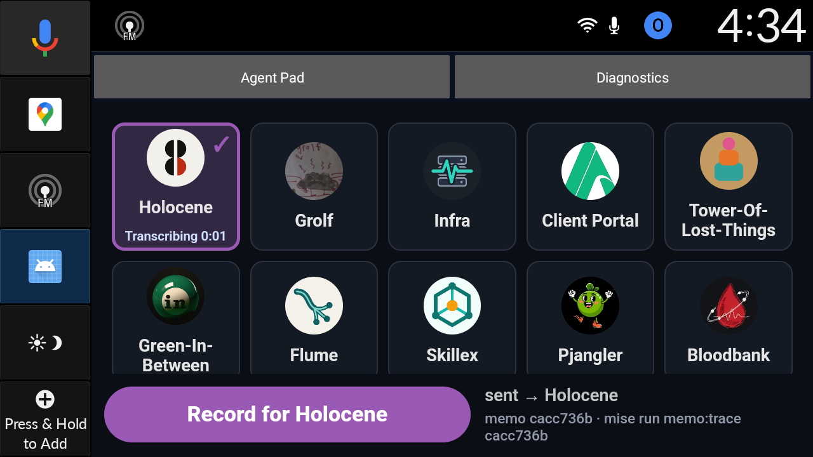 parked, A2 sent: tile "Transcribing 0:01" | 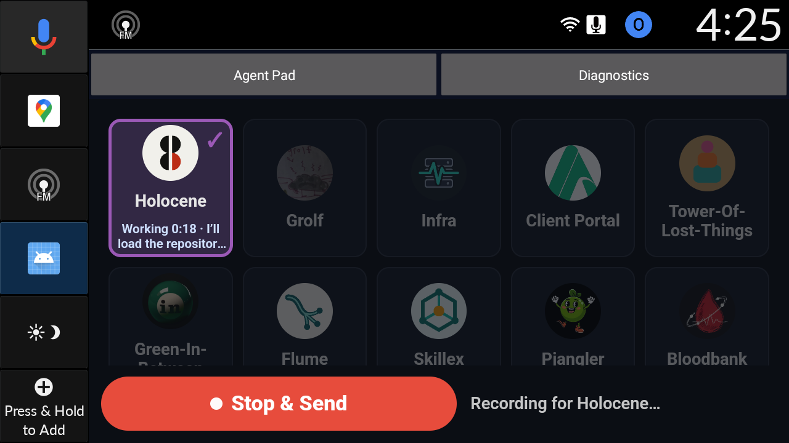 recording C while A works: "Working 0:18 · I'll load the repositor..." |
| 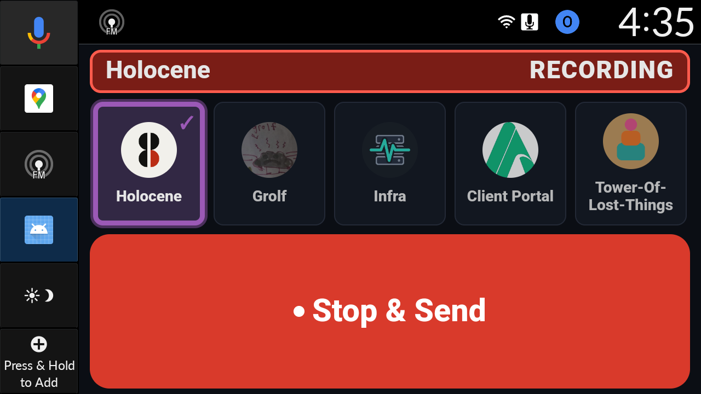 driving, B recording (wheel) |  driving: static "Working 0:06" |
| 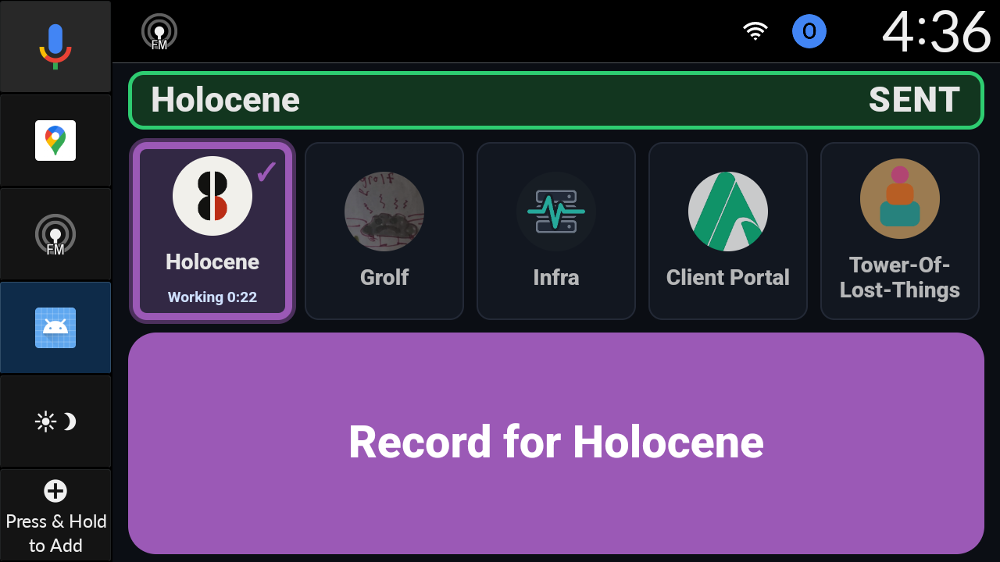 the same line 16 s later, only the clock text changed | 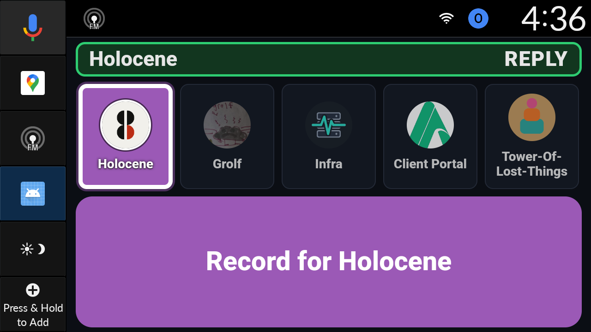 driving: banner REPLY while the reply plays |
| 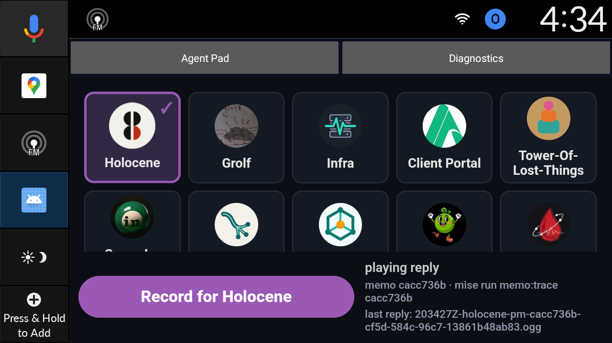 parked: "playing reply" | 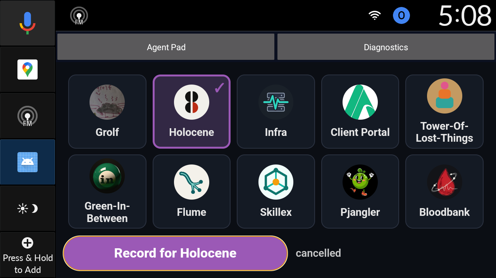 left parked, app open |

## Review round (after the proof): fixes verified on the sim

An independent review of the proof found that a recording started over a playing reply skipped the 350 ms drain (the
page stops its reply 16-55 ms before it asks to record), that the phone's Earshot copy of every reply could play
through the car's speakers (twice, or into a recording), and that every pad played every reply. Fixed in `3c0b10a`
and `f5b460e` (holocene); verified on the cold-booted sim (debug APK from `f5b460e`), memo `e28ef9f3` (uploaded as
the sim car with its device id, so the server-side path is the real one; gRPC mic injection crashed the emulator twice
this session):

| check | result |
|---|---|
| reply cut by a recording start | `halt reply reason=stopped`, 49 ms later `deferred arming reason=drain`, `start arming` 381 ms after the halt. On the speakers the reply's last sound ended 310 ms after the halt, 71 ms BEFORE the prompt started (before the fix: 230-383 ms into it). |
| recording focus | `dumpsys audio` during the note: `RecordingFocus` holds `GAIN_TRANSIENT_EXCLUSIVE`, `USAGE_ASSISTANT`; released after the mic closed, after the ack took its own focus. |
| Earshot | `memo:trace`: `phone_object OK not mirrored to the phone: the car that sent the memo was connected and spoke the reply itself`; `presence` answered `car_live` from the upload's device headers (also stored as S3 metadata). |
| ack on the memo | the note recorded over the reply (`8f2461ea`): `car speech` lists `ack deferred / start / end` and the SENT tone's `ack drop expired`; `timing since upload (server clock): ack -0.1s`. |
| second tap while arming | ignored: one `arm`, no `halt arming`; the button reads `Starting…` (shots/10). |
| speaker-level audit | `ttfr/overlap-5-review-fixes.txt`: ZERO OVERLAPS on all six checks (6 utterances, 2 recordings). |

Check 3 changed with this round: the Honda HAL opens its assistant mix on FOCUS, not on sound, so the recording's own
exclusive focus opened an (empty) mix for the whole note. A mix now counts only while an assistant focus holder other
than `RecordingFocus` has focus; a logcat filtered to the AMP lines (the earlier evidence) keeps the old rule and
re-audits unchanged (36 HAL windows, ZERO OVERLAPS).

Not verified on the sim: the TTS focus refusal and loss paths (no call or assistant to trigger them), the browser
fallback path (the car always records natively), the driving hero's REPLY label after a cancel. The real car gets the
native changes with the next Play release; the pad, proxy, watcher and /voice changes are live now.

## Files

- Tools (committed): `apps/auto/tools/sim_audio_tap.py` and `apps/auto/tools/speech_overlap.py`.
- Run helpers (copied here as a record; they expect `/tmp/ttfr` paths): `ttfr/drive_memo.py`, `ttfr/timeline.py`
  and `ttfr/beep_gap.py`.
- Data:
  - `ttfr/speech-logcat.txt`: HoloceneSpeech, Wheel, Reply and NativeRec lines, plus the OS capture and HAL mix lines.
  - `ttfr/speaker-tap.jsonl.gz`: every speaker packet as `{t, n, rms}`, host clock.
  - `ttfr/runs/*.json`: host times of each press and injection.
  - `ttfr/traces/*.txt`: memo:trace output.
  - Review round: `ttfr/speech-logcat-review-fixes.txt`, `ttfr/speaker-tap-review-fixes.jsonl.gz` (offset -718 ms),
    `ttfr/overlap-5-review-fixes.txt`.

## Round 2: full memos on the final build, with an overlap torture

Date: 2026-10-20, 22:44-23:36 UTC. Debug app from holocene `main` at `f249890` (code of `f5b460e`), installed by
`mise run auto:dev` with the Play installer of record, version not bumped (0.2.9-internal). Evidence in
[`ttfr/round2/`](ttfr/round2/). This closes the gap in the round 1 verdict: replies, progress clips and echoes now ran
on the final build, with real memos.

### Verdict

1. **Time to first response holds on the final build.** After Stop & Send the STOP tone sounds at +0.38-0.44 s and
   the spoken ack at +1.04-1.05 s. The heard echo comes at +7.3 s (driving) and +15.7 s (parked, under host load).
2. **Zero overlaps.** 50 utterances and 11 recordings, checked by the speaker-level audit (all 6 checks) and,
   separately, by a new server-side check of the pad's speech events. Nothing played into a recording. Nothing
   played over another utterance. That includes a recording over an echo, progress arriving during a recording and
   during a reply, and a reply arriving during another reply and during a progress clip.
3. **New defect: after a recording, the STOP confirmation can be lost.** A progress clip or echo of an earlier memo
   that was held back by the recording plays first, and the new memo's STOP tone and ack wait behind it. Memo Y got
   no STOP tone, no ack and no SENT tone at all. See "Findings".
4. **A gateway outage cost two memos.** From 22:50 to 23:22 every Bloodbank command was closed in 0.1 s with no
   agent turn. Another session's `systemctl --user reload hermes-gateway` started a drain that waited on a 2-hour
   skillex-pm turn. Memos L and C failed with `no_reply_text`, and the car said nothing about it.

### Preconditions

| check | result |
|---|---|
| sim | `emulator-5554` windowed; `mise run auto:dev`, installer `com.android.vending` (DO honoured while driving) |
| `mise run auto:sim:mic-check` | `OK (rms 26.6 peak 145)`; after the cold boot `OK (rms 24.9 peak 116)`; at the end, after restoring the mic route, `OK (rms 25.5 peak 106)` |
| watcher | `holocene-inbox-watcher.service` active |
| gateway lanes | both pulling; interactive ack_pending 0, batch 1-2 (a long skillex-pm turn on the batch lane); memos ride interactive |
| clocks | device = host - 720 ms before the crash; -57 ms after the cold boot, drifting to -88 ms (adb samples in `runs/clock-*.txt`) |
| host load | load average 21-24 on 32 cores during memos A and B (another agent's kokoro TTS at ~1400% CPU), about 7 at the end |
| Earshot | every reply: `not mirrored to the phone: the car that sent the memo was connected` (`earshot_skipped=car_live`). Only the sim played replies; Jarad's car was not connected |

**Memo input changed after a crash.** gRPC `injectAudio` stalled on memo L's second clip (`deadline_exceeded`, then
`There can be only one microphone active`) and the emulator crashed. That is the third crash from gRPC injection; the
attempt uploaded nothing (`record_failed`). After the cold boot I routed the emulator's capture stream to a
PulseAudio null sink (`pactl move-source-output <qemu> holo_testmic.monitor`) and played each phrase into it with
`paplay` ([`drive_memo_pa.py`](ttfr/round2/drive_memo_pa.py)). At the end I moved the stream back to the default
source *before* unloading the sink, and `mic-check` passed with no restart.

### The memos

All went to holocene-pm, phrase spoken by flite `slt`.

| memo | id | how | what it shows |
|---|---|---|---|
| A | `7d33527d` | parked, tap | timeline (round 1 phrase: date + board, two sentences) |
| B | `e2928012` | driving (`sim_drive.sh drive`), wheel `playpause` | timeline; static driving tile |
| L | `8d240058` | parked, tap | the agent's turn being worked on during recording C; failed (gateway drain) |
| C | `9c1d19c0` | parked, tap, held 31 s | recording started during L's echo; failed (gateway drain) |
| X, Y | `868a91aa`, `94127309` | parked, tap; Y recorded 13-42 s after X's Stop | X `sleep 40` (49 s turn): its progress arrives during recording Y; Y's reply arrives during X's reply |
| R, P | `bd75bd2d`, `fc42f9ac` | parked, tap | R's reply arrives during recording P; P's echo arrives during R's reply |
| S, Q | `d23a5e96`, `dafbd8b6` | parked, tap | S's 27 s reply (4 chunks); Q's progress and echo arrive during it |

Full tables: [`round2/timelines.md`](ttfr/round2/timelines.md). Traces: [`round2/traces/`](ttfr/round2/traces/).

### Time to first response

Timed from Stop & Send (the adb input). "Audible" is the first speaker-tap packet above silence.

| step | A parked | B driving | round 1 A2 / B | baseline (Oct 19-20) |
|---|---|---|---|---|
| STOP tone audible | **+0.44 s** | **+0.38 s** | +0.40 / +0.35 s | none |
| spoken ack audible ("Got it, Holocene's on it.") | **+1.05 s** | **+1.04 s** | +1.15 / +0.94 s | none |
| upload fact | +1.37 s | +0.32 s | +0.30 / +0.22 s | < 2 s with pickup and dispatch |
| transcribed | +11.02 s | +6.06 s | +7.49 / +5.61 s | 5-6 s (21-43 s on CPU) |
| heard echo audible | **+15.73 s** | **+7.27 s** | +8.84 / +7.00 s | none |
| agent turn | 19.4 s | 17.4 s | 11.5 / 16.6 s | 102-231 s |
| progress | line 1 at 12.5 s into the turn; its clip was rendered from 15 s and dropped when the turn ended (`narration_dropped turn_finished`) | line 1 at 13.2 s; turn over before 15 s | none | none |
| agent done | +30.67 s | +23.77 s | +19.26 / +22.46 s | |
| reply chunk 1 up | +42.05 s (done +11.4 s) | +30.74 s (done +7.0 s) | done +4.9 / +5.6 s | full reply only, after 8-19 s TTS |
| **reply audible** | **+44.28 s (done +13.6 s)** | **+31.81 s (done +8.0 s)** | done +5.5 / +6.2 s | done + 8-19 s TTS + 0.9-8.4 s car lag |
| chunk 1 up to audible | 2.2 s | 1.1 s | 0.6 s | 0.9-8.4 s after the replied fact |
| reply ended | +61.78 s (3 chunks) | +48.89 s (2 chunks) | | |

**Spoken progress** (from the memos with longer turns):
- **P** (`sleep 30`, 41.6 s turn): the agent's line 1 came 9.0 s into the turn. Its clip was up at +27.95 s and audible
  at +30.10 s, after 1.5 s behind P's own echo.
- **X** (`sleep 40`): the clip was up 19.4 s after dispatch, while recording Y was open. It was held back and played
  when the mic closed.
- The parked tile read "Working 0:29 · I'll check the system..." for A (shot 01). Driving shows the static "Working 0:05"
  (shot 03) and the REPLY banner during the reply (shot 04). No animation; only the clock text changes.

**Compared with round 1 and the baseline:**
- The ack is unchanged: the first sound comes under half a second after the press.
- B matches round 1. A ran during the worst of the host load, and every server step was slower. The watcher noticed
  the upload 2.1 s late, and the 42 KB download took 1.7 s. The echo came 4.0 s after the transcribed fact (B: 0.6 s).
- **A's reply lag was not vox.** vox's own log has chunk 1 rendered at done +4.2 s (`synth.completed text_len=78` at
  22:47:08.27). The voiced fact came 6 s after that. Chunks 2 and 3 show the same 6-9 s gap between render and upload.
  With less load (R, S) chunk 1 was up 3.8-4.7 s after the agent finished, and on B the gap was 0.6 s. Under heavy
  load, the chunk upload/publish step is where time is lost.
- Against the baseline, the fixed costs are gone. There is an ack at about 1 s, an echo at 7 s, and the reply starts
  4-14 s after the agent finishes. Before, the reply came after the whole render plus up to 8 s of car lag. The agent's
  turn is still most of the wait.

### Overlap torture

Queue decisions from HoloceneSpeech (device epoch seconds, memo ids shortened), from
[`round2/speech-logcat.txt`](ttfr/round2/speech-logcat.txt).

1. **A recording started during an echo (C over L's echo).** Arming halts the echo. The prompt waits out the drain
   (328 ms), and the mic opens after the beep:
   ```
   854.326 halt echo id=echo:8d240058 reason=recording
   854.353 deferred arming reason=drain
   854.681 start arming
   857.102 mic recording            (until 888.542)
   ```
   On the speakers, the echo's last sound ended 13 ms into the arming start. There were 351 ms of silence before the
   prompt, and the beep ended 269 ms before the mic opened.
2. **Progress arrives during a recording (X's clip during Y).** It is held back for the whole note, then played:
   ```
   805.639 mic recording
   816.319 deferred progress id=progress:868a91aa:1 reason=recording
   831.500 mic idle
   831.501 start progress id=progress:868a91aa:1 waited_ms=15183
   ```
3. **A reply arrives during a recording (R's chunk 1 during P).** It was up at 23:29:47.1 while P was recording. It
   started only after the mic closed and P's STOP ack ended (`989.851 queued reply ... behind_ack`, `992.258 start
   reply`).
4. **A reply arrives while another reply plays (Y during X).** Y's reply was up at 23:27:55.4, inside X's reply
   (23:27:45.8-23:28:13.4). It started 0.1 s after X's ended (`893.488 end reply 868a91aa chunks=3`, `893.594 start
   reply 94127309`).
5. **Progress arrives during a reply (Q's clip during S's reply).** It never cut the reply:
   ```
   1104.691 start reply 233139Z-...-d23a5e96 (4 chunks)
   1111.928 queued echo id=echo:dafbd8b6 reason=behind_reply
   1130.617 queued progress id=progress:dafbd8b6:1 reason=behind_reply
   1131.722 end reply d23a5e96 chunks=4
   1131.733 start echo dafbd8b6 waited_ms=19805
   1135.789 start progress dafbd8b6:1 waited_ms=5172
   ```
6. **A reply arrives during another memo's progress (X's reply behind Y's clip).** Nothing preempts a playing clip.
   The reply waited 5.07 s (`860.476 queued reply ... behind_progress`).
7. **An echo arrives during a reply.** P's echo waited 15.6 s behind R's reply, and Q's waited 19.8 s behind S's.

### Overlap check output

Two independent checks:
- `apps/auto/tools/speech_overlap.py`, the speaker-level audit with 6 checks: queue, app mic and OS capture, HAL mix,
  and speaker tap.
- [`round2/proxy_overlap.py`](ttfr/round2/proxy_overlap.py), new. It rebuilds utterances and mic windows from the
  `speech` events the pad posted to the upload proxy, on the device's monotonic clock. It is a second path, so it also
  shows the server-side record is complete.

| window | memos | speech_overlap.py | proxy_overlap.py |
|---|---|---|---|
| before the crash | A, B, the crashed L attempt | **ZERO OVERLAPS**, 6/6 PASS (12 utterances, 3 recordings, 12 HAL windows) [`overlap-1`](ttfr/round2/overlap-1-memos-A-B.txt) | **ZERO OVERLAPS** (12 utterances, 3 mic windows) |
| after the cold boot | L, C | **ZERO OVERLAPS**, 6/6 PASS (8 utterances, 2 recordings) [`overlap-2`](ttfr/round2/overlap-2-memos-L-C.txt) | **ZERO OVERLAPS**, combined with the torture window: 38 utterances, 8 mic windows [`overlap-proxy-side`](ttfr/round2/overlap-proxy-side.txt) |
| torture | X, Y, R, P, S, Q | **ZERO OVERLAPS**, 6/6 PASS (30 utterances, 6 recordings, 29 HAL windows, 130 s of sound) [`overlap-3`](ttfr/round2/overlap-3-torture-X-Y-R-P-S-Q.txt); the same at offsets -40 and -130 ms | (see above) |

```
PASS  1 speech x speech (queue): 0 overlaps
PASS  2 speech x recording (queue vs app mic + OS capture, tolerance 30 ms): 0 overlaps
PASS  3 HAL assistant mix x OS capture (tolerance 30 ms): 0 overlaps
PASS  4 speaker output x mic open (tap, tolerance 30 ms): 0 overlaps
PASS  5 speaker output with no owning utterance (latency 700 ms): 0 overlaps
PASS  6 a sound running into the next utterance (no silence within 700 ms of its start): 0 overlaps
      speaker output: 98 spans, 130.1 s of sound in the window
RESULT ZERO OVERLAPS  (30 utterances, 6 app recordings, 6 OS capture windows, 29 HAL mix windows)
```

To rerun:
```bash
E=_bmad-output/implementation-artifacts/agent-pad-auto/ttfr/round2
zcat $E/speaker-tap-2-after-cold-boot.jsonl.gz > /tmp/tap2.jsonl
python3 apps/auto/tools/speech_overlap.py --logcat $E/speech-logcat.txt --tap /tmp/tap2.jsonl --offset-ms=-88 --from 1792538770 --to 1792539165
docker logs agent-pad-upload 2>&1 | python3 $E/proxy_overlap.py --since 2026-10-20T22:52:30 --until 2026-10-20T23:36:00   # while the container's log still holds that window
```

### Findings (not fixed in this round)

1. **The stopping memo's STOP tone and ack lose to stale speech from an earlier memo.** In the arbiter, rank is
   reply > cue > echo > progress > ack, and the ack expires after 6 s (`ACK_WAIT_MS`). A recording holds back
   whatever arrives during it. When the mic closes, that backlog outranks the new memo's ack, and the STOP tone is
   part of that ack:
   - **Y:** X's progress clip, held back for 15.2 s, played first. Y's `ack:stopped` and `ack:sent` were then
     `drop ... reason=expired`. On the speakers, the first sound after Stop was X's clip at +0.93 s. There was no STOP
     earcon (`segments.py` in timelines.md). The driver had no audible sign that the note stopped and was sent.
   - **C:** L's echo had been cut by C's arming and was requeued. It played again in full after C (waited 34.2 s).
     C's ack waited 5.3 s behind it, and C's SENT tone expired.
   - **Suggested fix** (SpeechArbiter, pure and JUnit-testable): when the mic closes, start the stopping memo's ack
     before any backlog. Drop a held-back progress clip older than a few seconds, since it is newest-wins and already
     stale. Drop an echo that was cut by a recording instead of replaying it.
2. **A reply waits behind another memo's progress clip.** X's reply waited 5.07 s behind Y's clip. This is not an
   overlap. A reply could cut a progress clip of a different memo the same way it cuts its own.
3. **A failed memo is silent in the car.** L and C ended `failed / no_reply_text`. Nothing was spoken, and the tile went
   back to "sent → Holocene" (shot 06). While driving, a failure looks the same as a slow agent.
4. **Gateway drain outage, 22:50:04-23:22:42 UTC.**
   - **Cause:** another session ran `systemctl --user reload hermes-gateway.service` (ExecReload = SIGUSR1 = a drained
     restart) while hiring `marge-simpson`. The drain waited on a skillex-pm batch turn that had been running since
     21:05 (`gateway_state.json`: `draining`, `active_work` = that turn). It waited until Hermes' own
     `restart_after_turn_timeout` (default 1800 s) ran out.
   - **Effect:** during the drain, the Bloodbank adapter closed every command as `completed/success` in about 0.1 s
     with no Hermes session.
   - **Recovery:** the gateway relaunched itself at 23:21:35 and Bloodbank reconnected at 23:22:42. I did not restart
     it. Any real car memo in that window failed the same way.
   - **Fix needed:** `reload` must not mean "refuse every command for up to 30 minutes", or fleet tooling must not use it.
5. **gRPC mic injection is not safe under load.** It crashed the emulator a third time. The PulseAudio route works,
   and it leaves the mic healthy if the stream is moved back before the sink is unloaded. DEV.md now says so.

### Side effects

- **Ten real memos to holocene-pm:** A, B, L, C, X, Y, R, P, S and Q. L and C failed in the gateway drain.
  No reply reached the phone (all `earshot_skipped=car_live`), and Jarad's car was not connected.
- **The sim is left running:** windowed, parked, app open, Holocene selected (shot 09). Host mic passthrough is on,
  the capture stream is back on the default source, and the null sink is removed.

### Screenshots

| | |
|---|---|
| 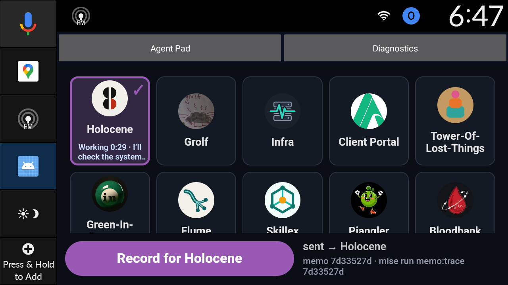 parked, A: "Working 0:29 · I'll check the system.." |  driving, B recording (wheel) |
|  driving: static "Working 0:05" | 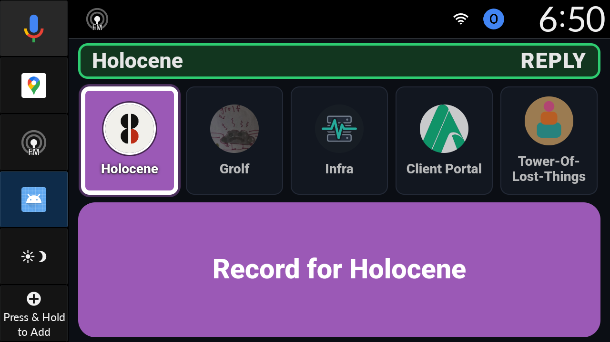 driving: REPLY banner while B's reply plays |
| 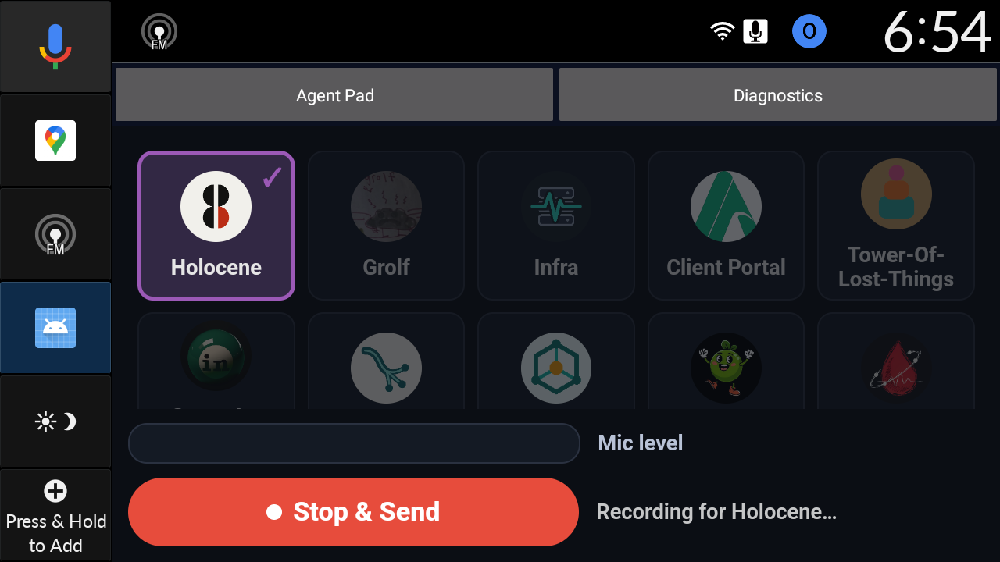 recording C (L's echo was cut by its arming) | 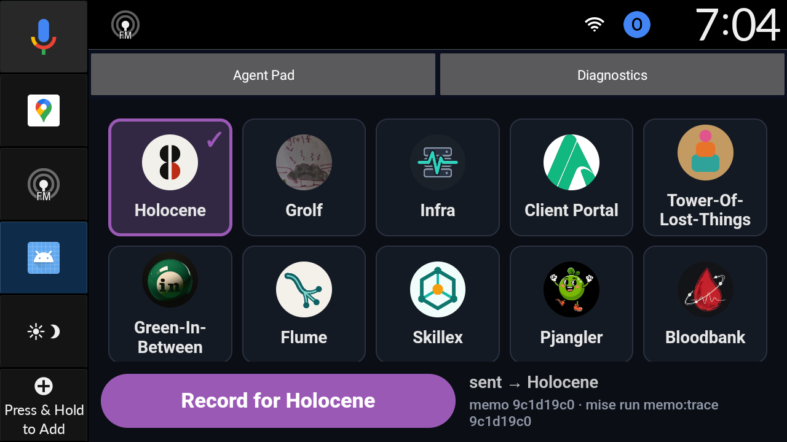 after L and C failed: no failure line, nothing spoken |
| 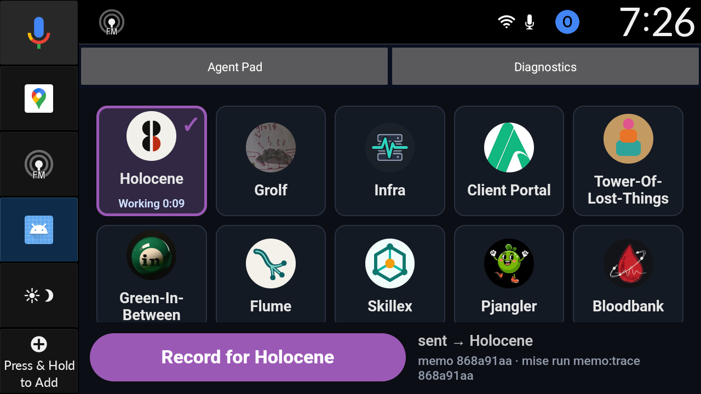 X working, before recording Y | 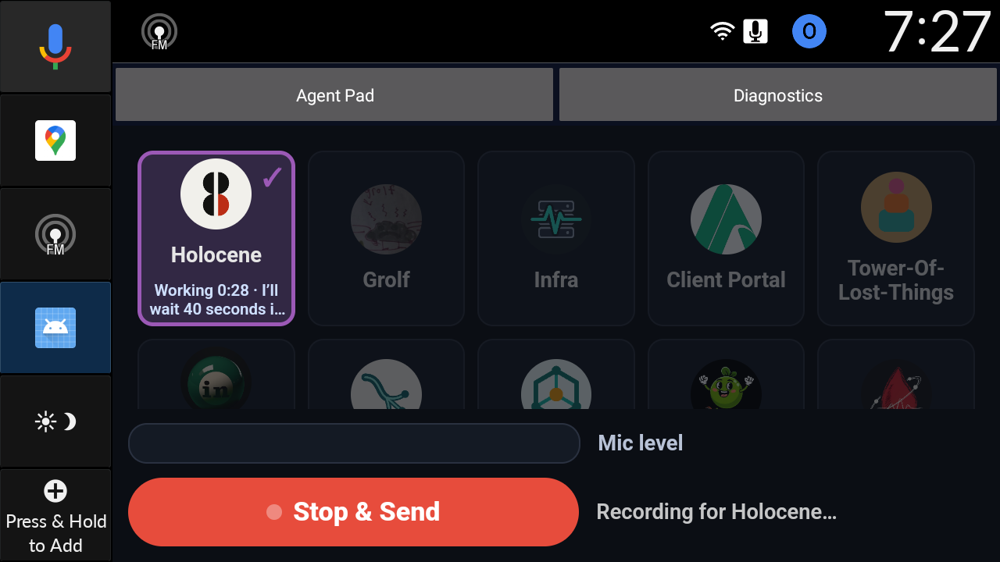 recording Y while X's progress clip waits |
| 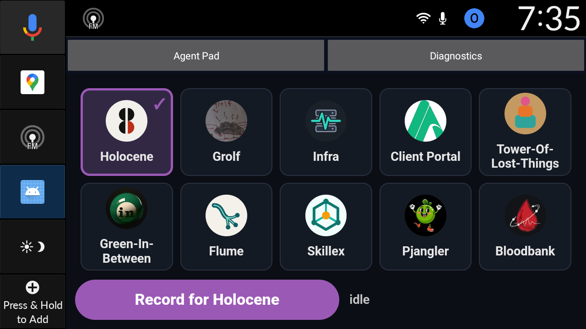 left parked, app open | |

### Files (round 2)

- `ttfr/round2/speech-logcat.txt`: HoloceneSpeech, Wheel, Reply and NativeRec lines, plus the OS capture and HAL lines.
- `ttfr/round2/speaker-tap-1-before-crash.jsonl.gz` (offset -720 ms) and `speaker-tap-2-after-cold-boot.jsonl.gz`
  (offset -57 to -88 ms).
- `ttfr/round2/runs/*.json`: host times of each press and clip; `runs/gateway-drain-poll.txt` is the drain poll.
- `ttfr/round2/traces/*.txt`: memo:trace for every memo, including the two failures.
- Helpers (they expect `/tmp/ttfr2` paths): `drive_memo_pa.py` (paplay input), `timeline.py` / `timeline2.py`,
  `segments.py` (tone versus speech onsets), `proxy_overlap.py` and `wait_gateway.sh`.

## Pre-v12 fixes

Date: 2026-10-21, 03:20-03:41 UTC. An independent re-check of round 2 left three open issues. All three are fixed at
the root in `f9f5aa1` (car) and `97bcdbf` (watcher, upload proxy, pad, /voice). Evidence is in
[`ttfr/pre-v12/`](ttfr/pre-v12/).

Deployment:
- The watcher (`holocene-inbox-watcher.service`) and the API (`holocene-api.service`) were restarted.
- The upload proxy (`agent-pad-upload`) and `holocene-web` were recreated.
- The pad was rebuilt into its live bind-mounted `dist/`.
- The debug app was installed on `emulator-5554` with `mise run auto:dev` (Play installer of record).

The app version was not bumped, so it is still 0.2.9-internal.

### 1. The phone copy goes out unless the car actually speaks the reply

**Bug.** The watcher left the Earshot phone copy out whenever the sending car was *connected*, which is presence. It
did not check whether the car played the reply. The edge keeps a dead car's push stream "open" for up to
`PUSH_MAX_AGE_S` + 30 s. So a reply that arrived just after the car was switched off was heard nowhere.

**Fix.** Exactly one of the car and the phone speaks a reply. The upload proxy decides which one, atomically
(`POST /upload/claim`, `ReplyClaims`):
- **The car.** The pad page, host `car`, holds every reply it means to play as soon as it learns of it. It renews the
  hold every 5 s while the reply waits (behind a recording or another reply), and claims the start when it plays. The
  hold is a 20 s lease. The car's playback beacon and its speech queue's `start` also count as a start.
- **The watcher.** Once the car's copy is up, the watcher offers the reply. A one-file reply is also pushed to the car
  as `offered` at that moment, so the car does not wait for `replied`. The watcher then takes the reply for the phone
  in two cases:
  - no car claimed it within 12 s of its first audio (chunk 1, or the one file);
  - the car's lease lapsed.

  While a live car holds the reply, the watcher waits (at most 300 s).
- **Who gives way.** The car does, and the phone owner is documented in `services/inbox-watcher/README.md`. The pad
  page is deployed live, while Earshot plays whatever lands in its channel. A granted take is final. A car that comes
  back later (an ignition, a reconnect) is refused both its hold and its start, and leaves the reply to the phone. A car
  that holds or started the reply makes the take fail. So the phone copy can never start while the car speaks the reply
  or holds it behind a recording.
- **Record.** The `replied` fact now waits for the decision and records it:
  - `earshot_skipped`: `car_spoke` or `car_holds`;
  - `earshot_reason`: `car_started`, `car_holds`, `no_car_claim`, `car_let_go`, `browser_sender`, `claim_failed` or
    `skip_off`;
  - `reply_up_at` and `earshot_wait_seconds`.

  `memo:trace` adds a `phone_decision` hop (or says why the copy was left out), and /voice prints the same sentence
  under the replied hop. The car-lag timings use `reply_up_at`, because the fact now comes after the decision.
- **Fail-open.** If the proxy cannot be asked (5 failed polls), the watcher mirrors. A car whose claim gets no answer
  plays. Both cases need the proxy to be down, and then memos cannot upload either. Claims are held in memory, so a
  proxy restart between a take and a car coming back could let both play, minutes apart.

**Proven on the sim:**

| memo | id | what happened | decision |
|---|---|---|---|
| A | `96cad0ae` | Agent done at 03:36:04.114. The app was force-stopped 0.35 s later, before the reply existed. The reply was up and offered at 03:36:09.78 (pushed, nobody claimed it). The phone took it at 03:36:21.87, the watcher dropped the copy at 03:36:22.45, and the S26 started it at 03:36:26.1. The app was relaunched at 03:36:40: its hold and start at 03:36:43.39 were both refused (`owner: phone`), and the car did not play the reply. | `earshot_reason: no_car_claim`, waited 12.2 s; trace `phone_decision OK mirrored to the phone: no car claimed it within the grace window ...` |
| B | `10a56377` | Normal memo, car live. The one-file reply was offered at 03:35:02.643. The car claimed its start 53 ms later and played it at 03:35:02.915, 0.27 s after the offer. | `earshot_skipped: car_spoke` (`car_started`), decided in 1.2 s; not mirrored |
| D | `a2516f66` | D's reply was up while recording E was open (E opened at D's agent done and was held 30 s). The car held the reply with 6 renewals, from 03:39:22.17 to 03:39:50.33. The longest gap between renewals was 7.5 s, inside the 20 s lease. The car claimed the start at 03:39:50.36, after E's STOP ack and SENT tone. | `car_spoke`, waited 29.4 s; not mirrored |
| Y1, Y2, E | `4f63901b`, `491e5b8e`, `c6b26402` | Car live. | `car_spoke`, 1.2 s each |

The proxy's claim lines are in [`pre-v12/claims.jsonl`](ttfr/pre-v12/claims.jsonl) and the traces in
[`pre-v12/traces/`](ttfr/pre-v12/traces/).

### 2. The stopping memo's STOP tone and ack play first

**Bug.** Speech that a recording held back outranked the new memo's ack, because the ack has the lowest rank and
expires after 6 s. Examples are an earlier memo's progress clip, or an echo that the arming cut and requeued. Memo Y got
no STOP tone, ack or SENT tone. Memo C's SENT tone expired, and L's echo was replayed in full after C.

**Fix** (`SpeechArbiter`, pure, JUnit):
- An ack that is offered while the mic is busy, or within 6 s of it closing, is the note's ack. It starts before
  anything else in the queue, whatever its rank. Oldest goes first: the STOP tone + "Got it, X's on it", then the SENT
  tone.
- Held-back progress follows the existing rules. A newer clip for the same memo replaces it, and the memo turning final
  (its reply) drops it.
- An echo or progress clip cut by a recording is requeued only while it is still the newest thing about its memo. If
  a newer progress clip or a reply is already queued, it is dropped at the cut. If one arrives later, or the memo turns
  final, the replay is dropped then.

**Proven on the sim (memo Y).**
1. Y1 (`4f63901b`, a `sleep 40` turn) was recorded. Recording Y2 started 14.0 s after Y1's Stop.
2. Y1's progress clip was held back 7.7 s into Y2 (`deferred progress ... reason=recording`).
3. Y2 was stopped 1.0 s later. The queue (device clock) then ran:

```
855.027 mic idle
855.027 start ack id=ack:stopped:17124729 waited_ms=47
855.210 queued ack id=ack:sent:17124958 reason=behind_ack,note_ack
857.621 start ack id=ack:sent:17124958 waited_ms=2412
858.163 start progress id=progress:4f63901b-...:1 waited_ms=4270
```

On the speakers, timed from the Stop press (host clock, `pre-v12/segments-after-stop-y2.txt`):

| time after Stop | sound |
|---|---|
| +0.32 s | the STOP tone (266 ms): the first sound after Stop |
| +0.93-2.52 s | "Got it, Holocene's on it." |
| +3.00 s | the SENT tone |
| +3.64 s | Y1's held-back progress clip |

No ack expired. In round 2, the first sound after Stop was X's clip at +0.93 s, with no STOP tone. The same ordering
held for memo E over D's held reply: E's STOP ack, E's SENT tone (`note_ack`, ahead of the reply), then D's reply.

The JUnit tests cover memo Y and memo C:
- the STOP ack, then the SENT tone, then the held-back clip;
- superseded and final backlog dropped;
- an echo cut by arming is said after the note's acks only while nothing newer exists;
- the replay is dropped by a later progress clip or reply;
- the replay is not requeued when a newer clip already waits.

### 3. A heard echo cut by a call comes back once

**Bug.** An echo cut by a phone call (focus loss) was dropped. That is fine for an ack, but not for the echo.

**Fix** (`SpeechArbiter.focusLost`, wired from `SpeechHost`):
- A heard echo that a call cuts, or whose focus is refused, is tried again every 2 s for 10 s.
- While the call is on, each try is refused and nothing sounds. The first try after the call ends says the echo.
- It is said again at most once: a second cut drops it.
- It is dropped if something newer about its memo arrives.
- An ack or a cue cut by a call is dropped, as before.

JUnit covers four cases: cut then said again, refused until the window closes, cut twice or superseded, and an ack
dropped. This path is **not exercised on the sim**, because the sim has no call to take the focus.

### Checks

| check | result |
|---|---|
| `./gradlew testDebugUnitTest lintDebug assembleDebug` | PASS, 187 JUnit tests (51 in `SpeechArbiterTest`, 12 new) |
| `mise run memo:test` | PASS (watcher 164, proxy 85: claim rules, claim HTTP, decision loop) |
| pad `tsc --noEmit`, `npm test`, `vite build` | PASS, 54 tests (4 new in `claim.test.ts`) |
| API / web typecheck, `voice-memos.test.ts` | PASS, 47 tests |
| `speech_overlap.py`, whole session (memos B, A, Y1, Y2, D, E: 30 utterances, 6 recordings, 6 OS capture windows, 30 HAL windows, 44 s of sound) | **ZERO OVERLAPS**, 6/6 PASS, at offsets -1088, -1040 and -1140 ms ([`overlap-session`](ttfr/pre-v12/overlap-session.txt)) |
| `proxy_overlap.py` (the pad's speech events at the proxy) | **ZERO OVERLAPS**, 30 utterances, 6 mic windows ([`overlap-proxy-side`](ttfr/pre-v12/overlap-proxy-side.txt)) |

To rerun:

```bash
E=_bmad-output/implementation-artifacts/agent-pad-auto/ttfr/pre-v12
zcat $E/speaker-tap.jsonl.gz > /tmp/tap.jsonl
python3 apps/auto/tools/speech_overlap.py --logcat $E/speech-logcat.txt --tap /tmp/tap.jsonl --offset-ms=-1088 --from 1792553675 --to 1792554020
```

### Side effects and state

- **Six real memos went to holocene-pm:** B, A, Y1, Y2, D and E.
  - A's reply was mirrored to the phone channel, and the S26 played it. That was the point of the test.
  - None of the others reached the phone.
- **Memo input** came through the PulseAudio null sink (`paplay`), never gRPC injection.
- **The sim is left** windowed, parked, with the app open. The capture stream is back on the default source and the
  null sink is unloaded. `auto:sim:mic-check` reports `OK (rms 25.9 peak 112)`.
- **Tools** are in [`pre-v12/tools/`](ttfr/pre-v12/tools/) and expect `/tmp/v12`:
  - `drive_y.py` records over a held-back clip;
  - `kill_on_done.py` force-stops the app at the agent's done;
  - `record_on_done.py` opens a recording at the agent's done.
